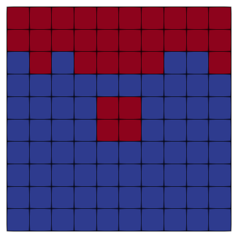
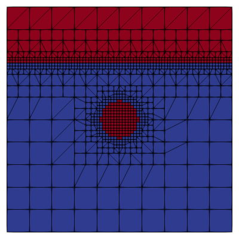

# Utilities

Listed below are the utilities that have been developed for blastFoam to simplify case setup and post-processing.

## setRefinedFields

This is a modified version of the setFields utility in the standard OpenFOAM that includes the ability to refine the mesh based on the fields that are set. This is extremely beneficial when a small volume needs to be set within a set of very large computational cells. The same functionality presented in Sec. 11 is present, allowing for 2D and 3D geometries to be set and refined, and the refinement options are specified in `setFieldsDict`, not `dynamicMeshDict`. The utility works by setting the default field values provided, setting the requested fields, then checking for local variations in specific fields. Region may have a level defined where the mesh is refined up to this level. The default field values for any fields being set must also be defined so that the region is updated at each iteration. The utility will iterate until the mesh is no longer changing, or the maximum number of iterations is reached.

A comparison using the standard `setFields` and `setRefinedFields` can be seen in Fig. 1.



(a) Unrefined initial field



(b) Refined initial field

Figure 1: Comparison of initial fields using `setFields` and `setRefinedFields`

By default, no error estimator will be used so any local change in a tracked field will be refined. However, by specifying an error estimator, the refinement will be determined by the method requested.

By default only fields that are specified within `setFieldsDict` will be modified, meaning that all other fields must use uniform field values to be read. The `-updateAll` command line option will read in all fields present in the current time step and update the sizes of the fields which is necessary if non-uniform fields will be used. If balancing is used this will automatically be enabled to ensure that all fields are correct.

In addition to the standard shapes that can be set with `setFields`, several additional options have been added and are listed below with their required entries. All `*MassToCell` options require "rho" and "mass" to be specified.

```sh
Usage: setRefinedFields [OPTIONS]
```

New cell sets:

- sphereListToCell: centres, radii, or radius
- cylinderCellToList: p1s, p2s, radii, or radius
- boxMassToCell: centre and aspectRatio (span for backup)
- cylindericalMassToCell: centre, LbyD and direction (radius and L for backup)
- sphericalMassToCell: centre (radius for backup)
- hemisphericalMassToCell: centre (radius for backup)
- searchableSurfaceToCell: surface (searchable surface type)
- searchableSurfaceToPoint: surface (searchable surface type)

The option to specify non-uniform values for the fields has also been included and are specified by using the field type (i.e. `volScalarField`, `pointVectorField`, etc.) followed by the type (i.e. `Value`, `Density`, etc.), for example `pointScalarFieldValue`, `volVectorFieldDensity`, etc.

Field set types:

- Density: A density is calculated using the given volume integrated quantity, and dividing by the volume of the selected cells
- Function: Values are set based on the specified function.
- InitialValue: The current field is read and saved to ensure the true values are used after refinement.
- MassIntegrated: The mass integrated quantity read and is divided by the mass (density times volume) of the given cell set to determine the field value.
- Sum: The field value is calculated given a summed value and the list of fields to use in the sum
- Value: A uniform value is set

Command line options:

| Variable | Description |
|---|---|
| -forceHex8 | Force 3D refinement for compatibility with standard OpenFOAM solvers |
| -debug | Write intermediate step with error and max cell level |
| -updateAll | Resize all fields from the current time |
| -overwrite | Write the mesh to previous location |
| -noFields | Do not write fields |
| -noRefine | Do not refine the mesh |
| -noHistory | Do not write the refinement history (fix the mesh) |

Dictionary options:

| Variable | Description |
|---|---|
| fields | Field names that are used to compute error and refine mesh |
| level | Level of each cell set |
| refineInternal | Are the cells inside each region refined |
| refineFaces | Are the owner and neighbor cells of faces refine (requires selectionMode) |
| refinePoints | Cells containing the points refined (requires selectionMode) |
| nBufferLayer | Number of cells between level boundaries (default is 0) |
| maxIter | Maximum number of iterations (default is 2*max(level) |
| errorEstimator | Type of error estimator used (default none) |

Field options:

| Variable | Description |
|---|---|
| -setBoundaries ("patches") | Set the boundaries provided |
| -setAllBoundaries | Set all boundary values |
| -noInternal | Do not set cell values |
| -evaluateBoundaries | Correct boundary conditions after setting |

Selection modes:

| Variable | Description |
|---|---|
| -all | Select all entries |
| -internal | Select all entries not on boundaries |
| -interface | Selected entries between selected and not |
| -boundary | Select entries on boundaries in the 'patches' entry |
| -interfaceAndBoundary | Select entries using 'interface' and 'boundary' |

Set and zone creation: The functionality of the `topoSet` utility is available in `setRefinedFields` allowing for creation of sets and zones using the refinement shapes. cell/face/point sets/zones are specified in separate lists, and multiple actions can be performed on the given sets. The usage is identical to that of `topoSet` and the `tutorials/setRefinedFields` case will offer an extensive list of usage options.

An example `setFieldsDict` is shown below

```cpp
fields (alpha.air);
nBufferLayers 1;
defaultFieldValues
(
volVectorFieldInitialValue U ( 0 0 0 )
volScalarFieldFunction p
{
// Function3 (i.e. uses x, y, and z)
type coded;
code
#{
return -x + 2.0*y*z
#};
}
volScalarFieldValue alpha.air 0
// alpha.water = 1 - (alpha.air + alpha.gas)
volScalarFieldSum alpha.water 1 (alpha.air alpha.gas)
volScalarFieldValue rho.air 1.225
);
regions
(
cylinderToCell
{
p1 (0 0 -1);
p2 (0 0 1);
radius 0.1;
level 3;
refineInternal yes;
backup
{
p1 (0 0 -1);
p2 (0 0 1);
radius 0.2;
}
fieldValues
(
volScalarFieldValue p 9.12e8
// alpha.air = 10 [kg] / sum(V * rho.air) [kg]
volScalarFieldMassIntegrated alpha.air 10
// rho.water = 500 [kg]/ Volume
volScalarFieldDensity rho.water 500.0
);
}
// Refine the faces in the "walls" patch
patchToFace
{
name walls;
level 2;
refineFaces yes;
selectionMode boundary;
}
);
```

The tutorial in `tutorials/setRefinedField` details how this an be used as well as the outputs of the `-debug` option.

> **NOTE:** Because OpenFOAM does not decompose both the time-based mesh (e.g. 0, 0.001, ... ) and the base mesh (located in constant), where both are required to use the mesh modified by `setRefinedFields`. Thus, if it is run in parallel, `setRefinedFields` must be run in parallel after the case has been decomposed.

## blastToVTK

In order to create smaller files for post-processing, `blastToVTK` can be used to create VTK files of a given patch with a set of fields. By Default the write interval will be the write interval of the VTK files, but optionally the `-dt` flag can be used to write interpolated, intermediate steps at the given interval. A `*.vtk.series` file will automatically be written for simplified viewing. By default the VTK files will be written in binary.

```sh
Usage: blastToVTK <patchName> [OPTIONS]
```

Command line options:

| Variable | Description |
|---|---|
| -ascii | Write ascii VTK files |
| -dt | Optional write interval |
| -interpolationScheme | Scheme used to interpolate between time steps (linearClamp by default) |
| -fields | List of fields to be written in the VTK files |
| -outputDir | Directory to write files to (VTK by default) |

## createTimeSeries

This utility simplifies the previous utility by simply creating a `*.*.series` file which provides the path to each time step of a VTK or STL file and allows viewing of the time series with the time in ParaView. Only one additional file is created for each sampled field in the directory provided. The given path must include files within time step folders. By default the relative path to the files will be used

```sh
Usage: createTimeSeries <path/to/timeFolders> [OPTIONS]
```

Command line options:

| Variable | Description |
|---|---|
| -absolute | Use absolute file paths |
| -outputDir | Directory to write the *.series file to |

## mergeProbes

This is a simple utility that can be used to calculate combine probes started at different times. By default, all files found in the start time folder will be merged.

```sh
Usage: mergeProbes <path/to/probes> [OPTIONS]
```

Command line options:

| Variable | Description |
|---|---|
| -force | Overwrite existing merged probes |
| -probeNames | Probed fields to merge (default is all) |

## calculateImpulse

This is a simple utility that can be used to calculate the impulse using a pressure probe file. If an overpressure file is found, that will be the default field to integrate, but this can be overridden with the `-p` option. If an overpressure file is provided the reference pressure will be 0 by default, other with `-pRef` should be provided.

```sh
Usage: calculateImpulse <path/to/probes> [OPTIONS]
```

Command line options:

| Variable | Description |
|---|---|
| -p | Name of pressure field |
| -pRef | Reference pressure [Pa] |
| -impulse | Name of file to write |
| -force | Overwrite existing impulse file |

## initializeAtmosphere

The initializeAtmosphere utility is used to initialize stable pressure and density fields such that the hydrostatic pressure gradient and gravitational acceleration force are balanced. The hydrostatic initialization procedure is a modified version of that available in OpenFOAM (OpenCFD Ltd., 2018a). Currently, there are two available models: hydrostatic and tabulated. The hydrostatic model dynamically solves for the hydrostatic pressure gradient and adjusts the density accordingly. The tabulated model reads a list of pressures and temperatures versus height to determine the density fields. An optional hydrostatic correction can be used once the table values have been set. See tutorials/initializeAtmosphere for an example.

Inputs can either be read from a dictionary or through the command line. If the tabulated option is requested, `system/atmosphereProperies` must be available.

```sh
Usage: initializeAtmosphere [OPTIONS]
```

Command line options:

| Variable | Description |
|---|---|
| -pRef | Reference pressure [Pa] |
| -hRef | Reference height, or the height at the lowest point of the mesh [m] |
| -phase | Name of the phase to set (only for multiphase) |
| -zone | Optional cellZone to set (all cells by default) |
| -type | Optional override of the model. (hydrostatic by default, no default if read from dictionary) |

## rotateFields

The `rotateFields` utility is can be used to map the fields of a 1-D or 2-D solution to that of a 2-D or 3-D solution, where the source and target meshes are used to determine the rotation. The rotation of vector and tensor fields are mapped using the local rotation tensor to ensure that the correct radial components are used. Only field present in the target case are mapped, however additional fields can be mapped. Because there are no values for these fields, the closest value on the source mesh is used for cells outside of the mapped cells. Iterative refinement can be used to iteratively rotate fields and refine the mesh using the refinement criteria found in `dynamicMeshDict` allowing for easier initialization when using AMR.

> **NOTE:** The mapping is not conservative currently so only the nearest cell value will be used which can result in certain flow features either being over or under emphasised.

```sh
Usage: rotateFields <sourceCase> [OPTIONS]
```

Command line options:

| Variable | Description |
|---|---|
| -sourceTime | Time in the source case to map (default is startFrom time in source case) |
| -sourceRegion | Region of the source case to map (only used for multi-region) |
| -targetRegion | Region of the target case to map to (only used for multi-region) |
| -extend | If a cell is outside of the source range, map to the closest cell (default is no) |
| -maxR | Cutoffradius to map (default is a big number) |
| -centre | Center of rotation on the source mesh (default is the center of the source mesh) |
| -uniform | Copy uniform fields to the target case (default is no) |
| -additionalFields | List of additional fields to map |
| -refine | Iteratively map, rotate and refine the mesh |
| -parallelSource | Map from a parallel source |
| -tets | Use cell tet decomposition (no by default) |

## convertLagrangianPositions

Because OpenFOAM has changed the write format of Lagrangian particles to barycentric coordinated in place of a point in physical space, ParaView is no longer able to read the positions of particles any more. To alleviate this problem, and allow ParaView to read Lagrangian fields (in serial and parallel), the `convertLagrangianPositions` will read in the standard OpenFOAM positions file, convert it to a format that ParaView can read and rewrite the positions file. If the positions need to be reverted to continue a simulation, the `-revert` optional will rewrite the original positions of the particles.

```sh
Usage: convertLagrangianPositions [OPTIONS]
```

Command line options:

| Variable | Description |
|---|---|
| -revert | Convert point positions back to original positions |

## reconstructParAll

A modified version of the standard OpenFOAM `reconstructPar` and `reconstructParMesh` has been added to allow for reconstruction of cases that have been balanced, something that will cause a fatal error with `reconstructPar`. Reconstruction of the mesh is automaically handled, meaning that `reconstructParMesh` does not need to be run prior. This also allows for reconstruction of blastFoam AMR refinement histories which is not typically supported.

> **NOTE:** If the mesh in the decomposed `processor*/constant` folder is different that that in the constant folder, the `-constant` must be used.

> **NOTE:** If the mesh in the 0 folder differs from that in constant the `-withZero` flag must be used.
