# Examples

Several validation and tutorial cases are presented to demonstrate the approach for setting up typical problems. Other validation and tutorial cases are available in the validation and tutorials directories, which can be found in the top level directory where blastFoam is installed. The cases presented here are

1. A single-phase, double Mach reflection. Located in `validation/blastFoam/doubleMachReflection`
2. A 1-D shock tube consisting of air and water. Located in `validation/blastFoam/shockTube_twoFluid`
3. A 2-D, three-phase case with two different detonating phases where the first explosive material is used to detonate the second charge using the pressure based activation model. Located in `tutorials/blastFoam/twoChargeDetonation`
4. An explosive charge of C-4 buried in sand. Located in `tutorials/blastEulerFoam/mine`
5. A charge causing the breakage of windows using burst patches. Located in `tutorials/blastFoam/burstingWindow_workshop`

Only modified, relevant input files are shown here, as all additional files (such as blockMeshDict and initial conditions) are contained in the respective directory for each case.

## Double Mach reflection

The double Mach reflection problem is a complex case based on Woodward and Colella (1984), which is meant to demonstrate the capabilities of the single phase solver within blastFoam. Coded boundary conditions for velocity, pressure, and density are used to correctly describe the shock behavior at the top boundary. The case uses the a single phase with the RK2-SSP ODE time integrator and HLLC flux scheme.

For the double Mach reflection, the boundary conditions must be set so that the fields on the top boundary follow the correct upstream and downstream shock conditions, which are

$ρ_R$ = 1.4 kg/m3, $p_L$ = 1 Pa, $T_R$ = 1 [K], $U_R$ = (0, 0, 0) m/s

$ρ_L$ = 8 kg/m3 $p_L$ = 116.5 Pa, $T_R$ = 20.3887 [K] $U_L$ = (7.1447, −4.125, 0) m/s

These conditions change based on the shock location, leading to a modified boundary condition for density, pressure, temperature, and velocity, which uses a codedFixedValue. The initial density field is defined using

```cpp
dimensions
[1 -3 0 0 0 0 0];
internalField
uniform 1.4;
boundaryField
{
    inlet1
    {
        type
        fixedValue;
        value
        $internalField;
    }
    inlet2
    {
        type
        fixedValue;
        value
        $internalField;
    }
    outlet
    {
        type
        codedFixedValue;
        value
        $internalField;
        name
        shockRho;
        code
        #{
            // Shock location (x)
            scalar xS =
            db().time().value()*11.2799
            + 0.74402;
            scalarField x =
            this->patch().Cf().component(0);
            operator==
            (
                pos(x - xS)*1.4
                + neg0(x-xS)*8.0
            );
        #};
    }
    walls
    {
        type
        zeroGradient;
    }
    defaultFaces
    {
        type
        empty;
    }
}
```

The velocity and temperature fields are initialized using the upstream and downstream values with the same evolution equations. The pressure field uses zeroGradient boundary conditions. The internal and boundaries are set using setFields with the setFieldsDict defined as

```cpp
defaultFieldValues
(
    volVectorFieldValue U (7.1447 -4.125 0)
    volScalarFieldValue T 20.3887
    volScalarFieldValue p 116.5
    volScalarFieldValue rho 8.0
);
regions
(
    rotatedBoxToCell
    {
        origin (0.16667 0 -1);
        i (8.66025 -5.0 0);
        j (5.0 8.66025 0 );
        k (0 0 2);
        fieldValues
        (
            volScalarFieldValue p 1
            volScalarFieldValue T 1
            volVectorFieldValue U (0 0 0)
            volScalarFieldValue rho 1.4
        );
    }
    boxToFace
    {
        box (0.74402 0.999 -1) (5 1.001 1);
        fieldValues
        (
            volScalarFieldValue p 1
            volScalarFieldValue T 1
            volVectorFieldValue U (0 0 0)
            volScalarFieldValue rho 1.4
        );
    }
);
```

The phaseProperties file is

```cpp
mixture
{
    type
    basic;
    thermoType
    {
        transport
        const;
        thermo
        eConst;
        equationOfState idealGas;
    }
    specie
    {
        molWeight
        11640.3; // normalizes pressure
    }
    transport
    {
        mu
        0;
        Pr
        1.0;
    }
    equationOfState
    {
        gamma
        1.4;
    }
    thermo
    {
        Cv
        1.785714286;
        Hf
        0.0;
    }
}
```

The case can be initialized and run using the following commands:

```sh
blockMesh
setFields
blastFoam
```

The final results are shown in the following figure.

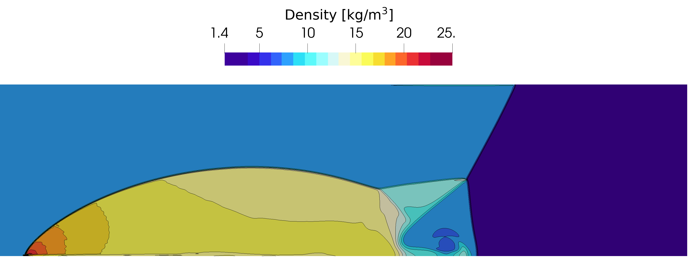

## Shock Tube - Two Fluid

This 1-D shock tube problem is taken from Zheng et al. (2011) and consists of gas and water initially separated at the center of the domain. The gas uses the van der Waals EOS and the water uses the Stiffened gas EOS. The shock tube is 1 m long, and is discretized into 300 computational cells. The left state is defined as:

$ρ$ = 1000 kg/m3

$α$ = 1

$p$ = 1e9 Pa

The right state is defined as:

$ρ$ = 50 kg/m3

$α$ = 0

$p$ = 1e5 Pa

The phaseProperties dictionary is:

```cpp
phases
(fluid gas);
fluid
{
    type
    basic;
    thermoType
    {
        transport
        const;
        thermo
        eConst;
        equationOfState stiffenedGas;
    }
    specie
    {
        molWeight
        18.0;
    }
    transport
    {
        mu
        0;
        Pr
        1.0;
    }
    equationOfState
    {
        gamma
        4.4;
        a
        6.0e8;
    }
    thermo
    {
        Cv
        4186;
        Hf
        0.0;
    }
    residualRho 1e-6;
    residualAlpha 1e-10;
}
gas
{
    type
    basic;
    thermoType
    {
        transport
        const;
        thermo
        eConst;
        equationOfState vanderWaals;
    }
    specie
    {
        molWeight
        28.97;
    }
    transport
    {
        mu
        0;
        Pr
        1.0;
    }
    equationOfState
    {
        gamma
        1.4;
        a
        5.0;
        b
        1e-3;
    }
    thermo
    {
        Cv
        718;
        Hf
        0.0;
    }
    residualRho 1e-6;
    residualAlpha 1e-10;
}
```

and the fvSchemes dictionary is:

```cpp
fluxScheme
HLLC;
ddtSchemes
{
    default
    Euler;
    timeIntegrator
    RK2SSP;
}
gradSchemes
{
    default
    leastSquares;
}
divSchemes
{
    default
    none;
}
laplacianSchemes
{
    default
    Gauss linear corrected;
}
interpolationSchemes
{
    default
    linear;
    reconstruct(alpha)
    vanLeer;
    reconstruct(rho)
    vanLeer;
    reconstruct(U)
    vanLeerV;
    reconstruct(e)
    vanLeer;
    reconstruct(p)
    vanLeer;
    reconstruct(speedOfSound) vanLeer;
}
snGradSchemes
{
    default
    corrected;
}
```

As seen above, the HLLC flux scheme is used with vanLeer limiters, and 2nd-order strong-stability-preserving time integration. The following commands were used to initialize and run the case in serial:

```sh
blockMesh
setFields
blastFoam
```

The results are shown in Fig. 3.

(a) Pressure

(b) X-velocity

Figure 3: Pressure and velocity fields at t = 73 ms

## Two charge detonation

This case demonstrates the ability of blastFoam to solve complex problems involving multiple phases and detonation dynamics. Two charges, one composed of RDX and the other of TNT, are detonated in air. The RDX has a single detonation point at the center of its circular domain, and the TNT is detonated using the pressure based activation model. Fig. 4 shows the initial configuration, where the red line is the outline of the RDX charge, the red dot is the initiation point of the RDX charge, and the blue line is the outline of the TNT charge.

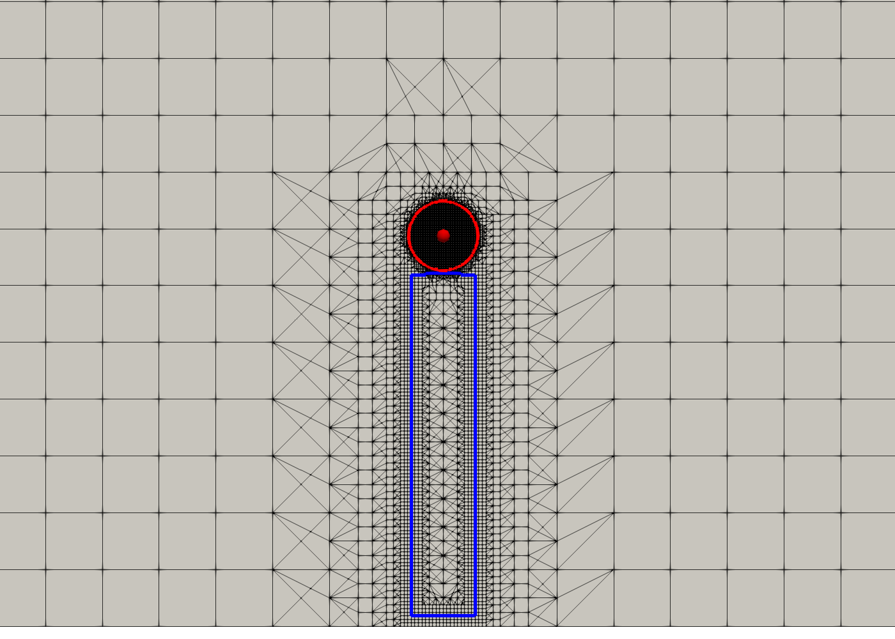

The phaseProperties dictionary is defined as

```cpp
phases (RDX tnt gas);
RDX
{
    type detonating;
    reactants
    {
        thermoType
        {
            transport
            const;
            thermo
            eConst;
            equationOfState Murnaghan;
        }
        equationOfState
        {
            rho0
            1160;
            n
            7.4;
            kappa
            3.9e11;
            Gamma
            0.35;
            pRef
            101298;
        }
        specie
        {
            molWeight 222.12;
        }
        transport
        {
            mu
            0;
            Pr
            1;
        }
        thermodynamics
        {
            Cv
            1130.78;
            Hf
            0.0;
        }
    }
    products
    {
        thermoType
        {
            transport
            const;
            thermo
            eConst;
            equationOfState JWL;
        }
        equationOfState
        {
            A
            2.9867e11;
            B
            4.11706e9;
            R1
            4.95;
            R2
            1.15;
            C
            7.206147e8;
            omega
            0.35;
            rho0
            1160;
        }
        specie
        {
            molWeight 55.0;
        }
        transport
        {
            mu
            0;
            Pr
            1;
        }
        thermodynamics
        {
            Cv
            1000;
            Hf
            0.0;
        }
    }
    activationModel none;
    initiation
    {
        E0
        4.0e9;
    }
    residualRho
    1e-6;
    residualAlpha
    1e-10;
}
tnt
{
    type detonating;
    reactants
    {
        thermoType
        {
            transport
            const;
            thermo
            eConst;
            equationOfState BirchMurnaghan3;
        }
        equationOfState
        {
            rho0
            1601; // Reference density [kg/m^3]
            K0
            9.6e9; // Bulk modulus [Pa]
            K0Prime 6.6; // dK0/dp []
            Gamma
            0.35; // Gruneisen coefficient
            pRef
            101298; // Reference pressure [Pa]
        }
        specie
        {
            molWeight 227.13;
        }
        transport
        {
            mu
            0;
            Pr
            1;
        }
        thermodynamics
        {
            Cv
            1095;
            Hf
            0.0;
        }
    }
    products
    {
        thermoType
        {
            transport
            const;
            thermo
            eConst;
            equationOfState JWL;
        }
        equationOfState
        {
            rho0
            1601;
            A
            371.21e9;
            B
            3.23e9;
            R1
            4.15;
            R2
            0.95;
            omega
            0.3;
        }
        specie
        {
            molWeight 55.0;
        }
        transport
        {
            mu
            0;
            Pr
            1;
        }
        thermodynamics
        {
            Cv
            1000;
            Hf
            0.0;
        }
    }
    activationModel pressureBased;
    initiation
    {
        E0
        7.0e9; // Detonation energy [Pa]
        // Ignition coefficients
        I
        0; // Ignition rate [1/s]
        // First stage coefficients
        G1
        3.5083e-7; // Activation rate [Pa/s]
        c
        1.0; // (1-lambda) exponent
        d
        0.0; // lambda exponent
        y
        1.3; // pressure exponent
        minLambda1
        0.0; // 1st stage start value
        // Second stage coefficients
        G2
        0.0; // Activation rate [Pa/s]
        pMin
        1.1e5; // Cutoff pressure
    }
    residualRho
    1e-6;
    residualAlpha
    1e-6;
}
gas
{
    type basic;
    thermoType
    {
        transport
        const;
        thermo
        eConst;
        equationOfState idealGas;
    }
    equationOfState
    {
        gamma
        1.4;
    }
    specie
    {
        molWeight 28.97;
    }
    transport
    {
        mu
        0;
        Pr
        1;
    }
    thermodynamics
    {
        Cv
        718;
        Hf
        0;
    }
    residualRho
    1e-6;
    residualAlpha
    1e-6;
}
```

The HLLC flux scheme is used with vanLeer limiters, and 2nd-order strong-stability-preserving time integration. The fvSchemes dictionary is defined as

```cpp
fluxScheme
HLLC;
ddtSchemes
{
    default
    Euler;
    timeIntegrator
    RK2SSP;
}
gradSchemes
{
    default cellMDLimited leastSquares 1;
}
divSchemes
{
    default
    none;
    div(alphaRhoPhi.tnt,lambda.tnt) Riemann;
}
laplacianSchemes
{
    default
    Gauss linear corrected;
}
interpolationSchemes
{
    default
    linear;
    reconstruct(alpha)
    vanLeer;
    reconstruct(rho)
    vanLeer;
    reconstruct(U)
    vanLeerV;
    reconstruct(e)
    vanLeer;
    reconstruct(p)
    vanLeer;
    reconstruct(speedOfSound) vanLeer;
    reconstruct(lambda.tnt) vanLeer;
}
snGradSchemes
{
    default
    corrected;
}
```

Because the circular charge domain is not well represented by the hexahedral mesh generated by blockMesh, refinement around this region is used. A maximum of four levels of refinement are used, with two cells between each level. This allows for a more accurate initial mass of the charges, and provides better initial resolution of the solution. The setRefinedFields utility is used where the setFieldsDict is defined as

```cpp
fields (alpha.RDX alpha.tnt);
nBufferLayers 1;
defaultFieldValues
(
    volScalarFieldValue alpha.gas
    1
    volScalarFieldValue alpha.RDX
    0
    volScalarFieldValue alpha.tnt
    0
);
regions
(
    cylinderToCell
    {
        refineInternal yes;
        level 6;
        p1 (0 0.55 -1);
        p2 (0 0.55 1);
        radius 0.05;
        fieldValues
        (
            volScalarFieldValue alpha.RDX
            1
            volScalarFieldValue alpha.gas
            0
        );
    }
    boxToCell
    {
        level 5;
        refineInternal no;
        box (-0.05 0.01 -1) (0.05 0.5 1);
        fieldValues
        (
            volScalarFieldValue alpha.tnt
            1
            volScalarFieldValue alpha.gas
            0
        );
    }
);
```

The following commands were used to run the case in parallel:

```sh
blockMesh
decomposePar
mpirun -np $nProcs setRefineFields -parallel
mpirun -np $nProcs blastFoam -parallel
```

The overpressure, density, and updated mesh are shown in Fig. 5, Fig. 6, and Fig. 7 for time states at 0.005 ms, 0.05 ms, and 0.15 ms, respectively.

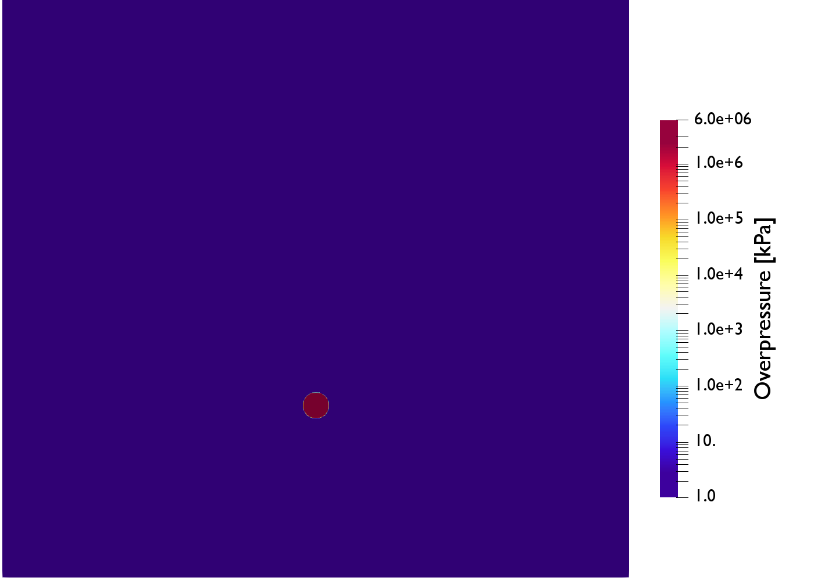

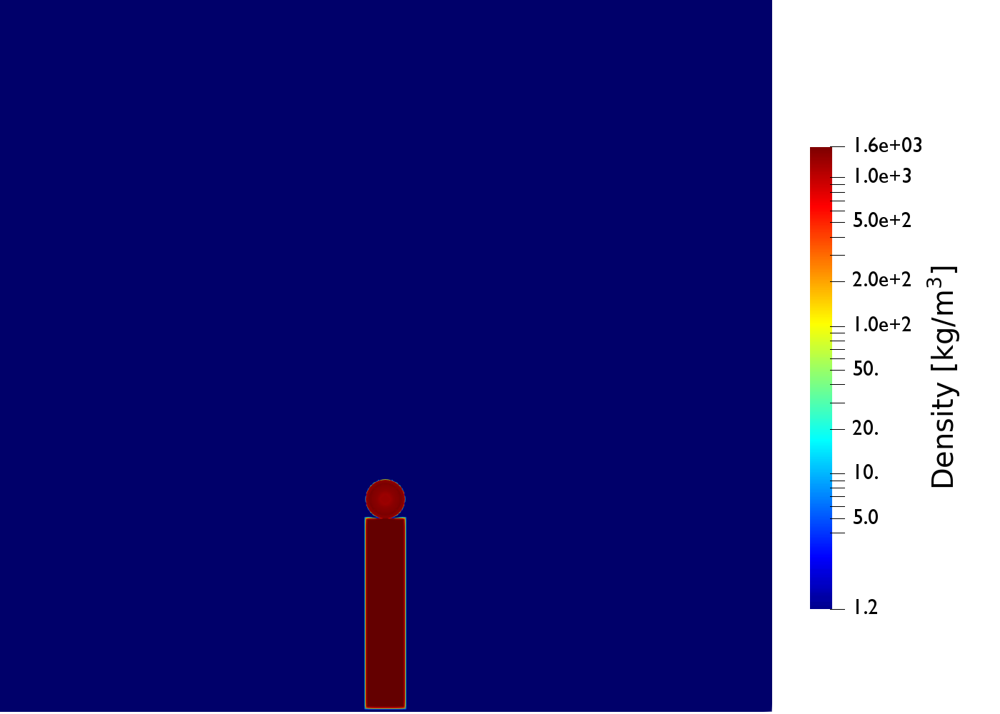

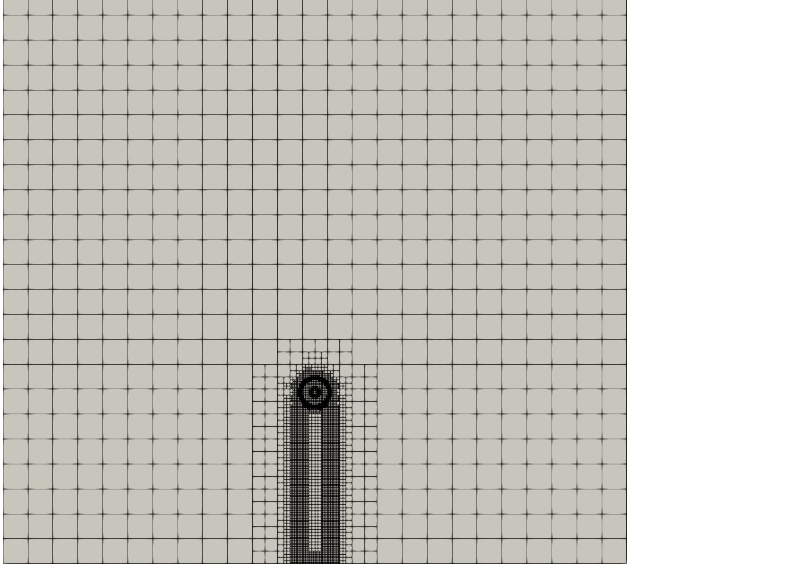

Figure 5: Instantaneous fields at t = 0.005 ms

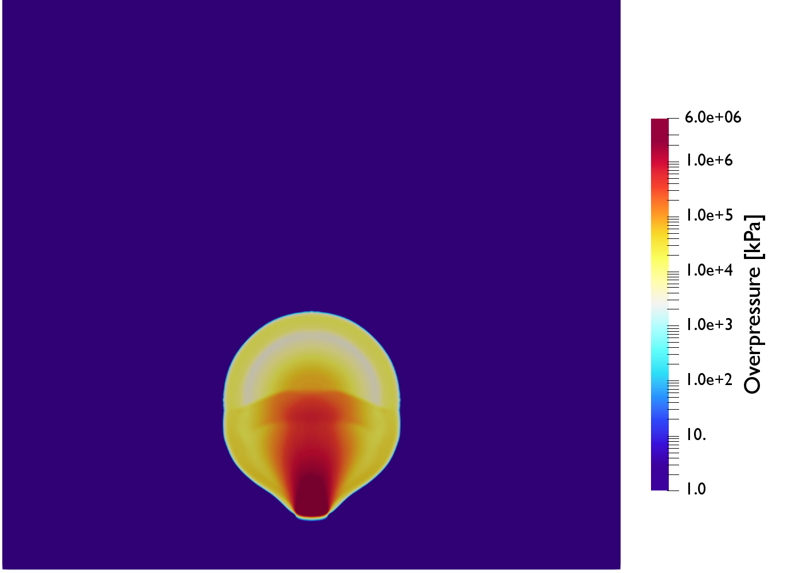

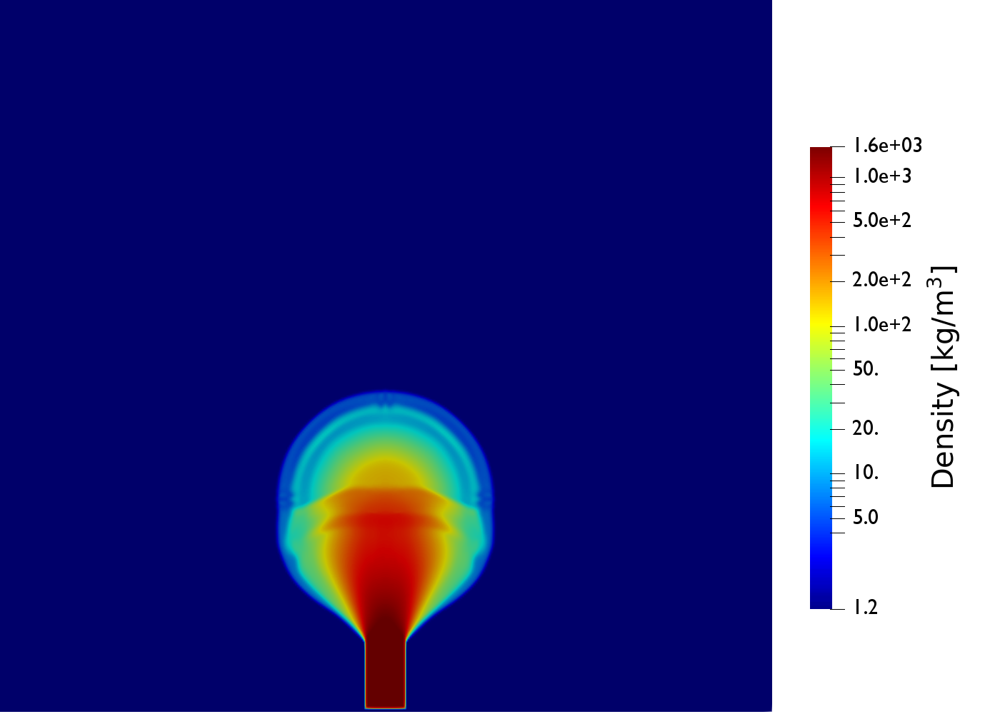

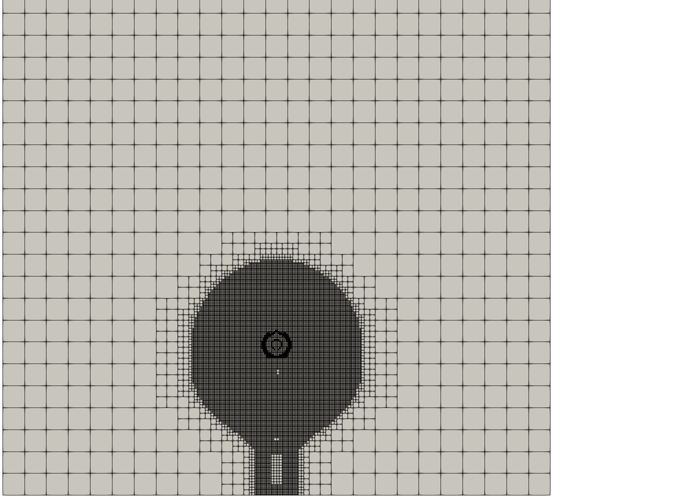

Figure 6: Instantaneous fields at t = 0.05 ms

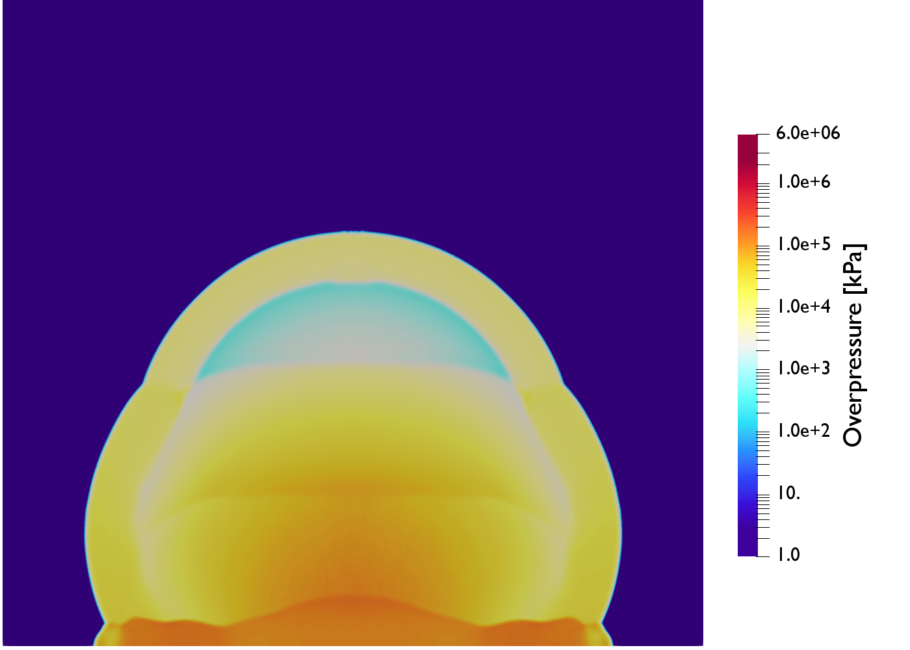

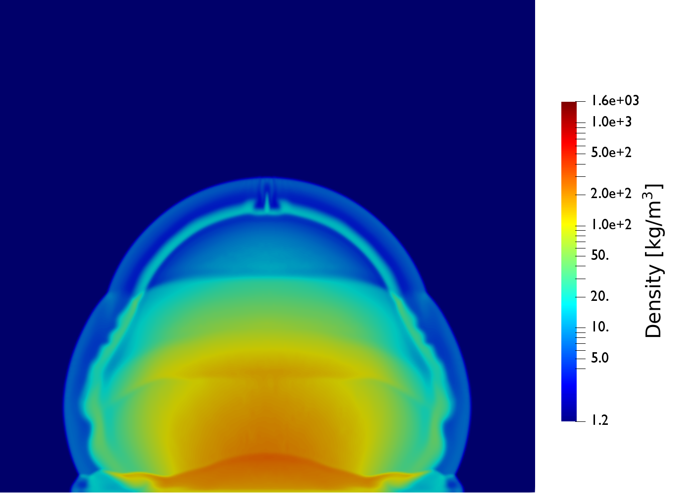

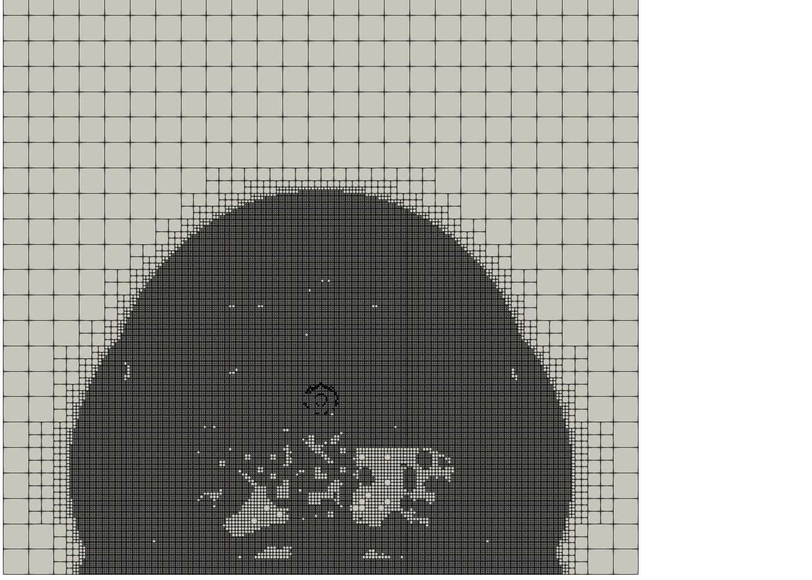

Figure 7: Instantaneous fields at t = 0.15 ms

## Mine (buried charge)

This case demonstrates the simulation of an underground detonation using blastEulerFoam, i.e., a mine. A C-4 charge is buried in a volume of particles (sand) and detonated, leading to the ejection of explosive gases and particles into the air above. The multiphase phase model is used to represent the air and C-4 gases. The particle phase is represented by the granular phase model with a density of 1470 kg/m3 and a diameter of 50 µm. The phaseProperties file is shown below:

```cpp
phases (particles gas);
particles
{
    phaseType
    granular;
    diameterModel constant;
    d
    50e-6;
    alphaMax
    0.65;
    alphaMinFriction 0.5;
    type basic;
    thermoType
    {
        transport
        constIso;
        thermo
        eConst;
        equationOfState rhoConst;
    }
    specie
    {
        molWeight 100.0;
    }
    equationOfState
    {
        rho0
        1470;
    }
    transport
    {
        kappa
        237;
    }
    thermodynamics
    {
        Cv
        987;
        // Heat capacity
        Hf
        0.0;
    }
    residualAlpha 1e-10;
    residualRho
    1e-6;
    kineticTheoryCoeffs
    {
        e
        0.9;
    }
}
gas
{
    phaseType
    multiphase;
    diameterModel
    constant;
    d
    0;
    phases (c4 air);
    c4
    {
        type detonating;
        reactants
        {
            thermoType
            {
                transport
                const;
                thermo
                eConst;
                equationOfState idealGas;
            }
            equationOfState
            {
                rho0
                1601;
                n
                7.4;
                kappa
                3.9e11;
                Gamma
                0.35;
                gamma
                1.35;
                pRef
                101298;
            }
            specie
            {
                molWeight
                55.0;
            }
            transport
            {
                mu
                1.81e-5;
                // Viscosity
                Pr
                1;
                // Prandtl number
            }
            thermodynamics
            {
                Cv
                1400;
                // Heat capacity
                Hf
                0.0;
            }
        }
        products
        {
            thermoType
            {
                transport
                const;
                thermo
                eConst;
                equationOfState JWL;
            }
            equationOfState
            {
                rho0
                1601;
                A
                609.77e9;
                B
                12.95e9;
                R1
                4.50;
                R2
                1.4;
                omega
                0.25;
            }
            specie
            {
                molWeight
                55.0;
            }
            transport
            {
                mu
                1.81e-5;
                // Viscosity
                Pr
                1;
                // Prandtl number
            }
            thermodynamics
            {
                Cv
                1400;
                // Heat capacity
                Hf
                0.0;
            }
        }
        residualRho
        1e-6;
        // Minimum density of the phase
        residualAlpha
        1e-10;
        // Minimum volume fraction used for divisi
        activationModel linear;
        initiation
        {
            E0
            9.0e9;
            points ((0 -1 0));
            vDet
            7850;
            // Detonation velocity [m/s]
        }
    }
    air
    {
        type basic;
        thermoType
        {
            transport const;
            equationOfState idealGas;
            thermo eConst;
        }
        specie
        {
            molWeight 28.97;
        }
        equationOfState
        {
            gamma
            1.4;
        }
        transport
        {
            mu
            1.81e-5;
            // Viscosity
            Pr
            1;
            // Prandtl number
        }
        thermodynamics
        {
            Cv
            718;
            // Heat capacity
            Hf
            0.0;
        }
        residualRho
        1e-6;
        residualAlpha
        1e-10;
    }
}
blending
{
    default
    {
        type none;
        continuousPhase gas;
    }
}
interfacialPressure
(
    (gas and particles)
    {
        type single;
        phase gas;
    }
);
interfacialVelocity
(
    (gas and particles)
    {
        type single;
        phase particles;
    }
);
aspectRatio
();
drag
(
    (particles in gas)
    {
        type GidaspowErgunWenYu;
        residualRe 1e-3;
        swarmCorrection
        {
            type none;
        }
    }
);
virtualMass
();
heatTransfer
(
    (particles in gas)
    {
        type RanzMarshall;
    }
);
lift
();
wallLubrication
();
turbulentDispersion
();
kineticTheory
{
    residualAlpha
    1e-6;
    radialModel SinclairJackson;
    viscosityModel Gidaspow;
    conductivityModel Gidaspow;
    granularPressureModel Lun;
    frictionalStressModel JohnsonJackson;
    JohnsonJacksonCoeffs
    {
        alphaMinFriction
        0.5;
        Fr
        0.05;
        eta
        2;
        p
        5;
        phi
        28.5;
        alphaDeltaMin
        1e-6;
    }
}
```

and the fvSchemes dictionary is:

```cpp
fluxSchemes
{
    gas
    {
        fluxScheme
        HLLC;
    }
    particles
    {
        fluxScheme
        AUSM+Up;
        alphaMinFriction
        0.5;
    }
}
ddtSchemes
{
    default
    Euler;
    timeIntegrator
    RK2SSP 3;
}
gradSchemes
{
    default
    cellMDLimited leastSquares 1;
}
divSchemes
{
    default
    none;
    div(alphaRhoPhi.c4,lambda.c4) Gauss Riemann;
    div((((alpha.gas*rho.gas)*nuEff.gas)*dev2(T(grad(U.gas))))) Gauss linear;
    div(sigma.particles) Gauss linear;
}
laplacianSchemes
{
    default
    Gauss linear corrected;
}
interpolationSchemes
{
    default
    linear;
    reconstruct(alpha)
    vanAlbada;
    reconstruct(rho)
    vanAlbada;
    reconstruct(U)
    vanAlbadaV;
    reconstruct(e)
    vanAlbada;
    reconstruct(p)
    vanAlbada;
    reconstruct(speedOfSound) vanAlbada;
    reconstruct(Theta)
    vanAlbada;
    reconstruct(lambda)
    vanAlbada;
}
snGradSchemes
{
    default
    corrected;
}
```

Because the spherical charge is not well represented by the hexahedral mesh generated by blockMesh, refinement around this region is used. A maximum of four levels of refinement are used, with two cells between each level. This allows for a more accurate initial mass of the charges, and provides better initial resolution of the solution. The setRefinedFields utility is used, and the setFieldsDict is

```cpp
fields (alpha.particles);
nBufferLayers 1;
defaultFieldValues
(
    volScalarFieldValue alpha.particles 0
    volScalarFieldValue alpha.c4
    0
    volScalarFieldValue alpha.air
    1
);
regions
(
    boxToCell
    {
        level 1;
        box (-25 -25 -0.1) (25 0 0.1);
        fieldValues
        (
            volScalarFieldValue alpha.particles 0.55
        );
    }
    sphereToCell
    {
        centre (0 -1 0);
        radius 0.5;
        level 2;
        refineInternal yes;
        backup
        {
            centre (0 -1 0);
            radius 1;
        }
        fieldValues
        (
            volScalarFieldValue alpha.particles 0
            volScalarFieldValue alpha.c4
            1
            volScalarFieldValue alpha.air
            0
        );
    }
);
```

The following commands were used to run the case in parallel:

```sh
blockMesh
decomposePar
mpirun -np $nProcs setRefineFields -parallel
mpirun -np $nProcs blastEulerFoam -parallel
```

Contour plots of the pressure and particle volume fraction are shown in Fig. 8, Fig. 9, and Fig. 10 at time states of 0.0002 s, 0.002 s, and 0.005 s, respectively. Note that the results shown here were mirrored during post-processing; the simulation used an axisymmetric domain.

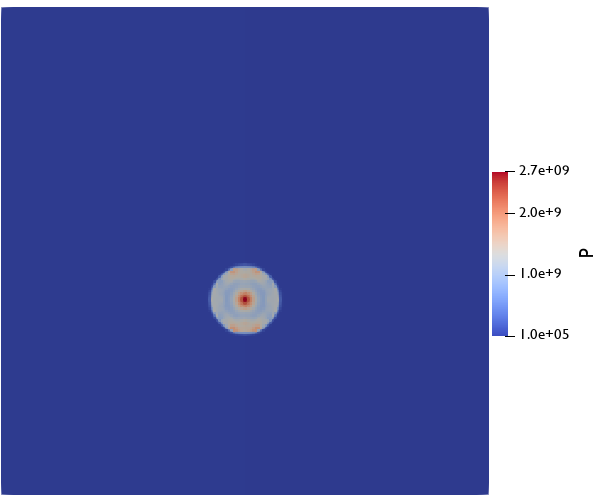

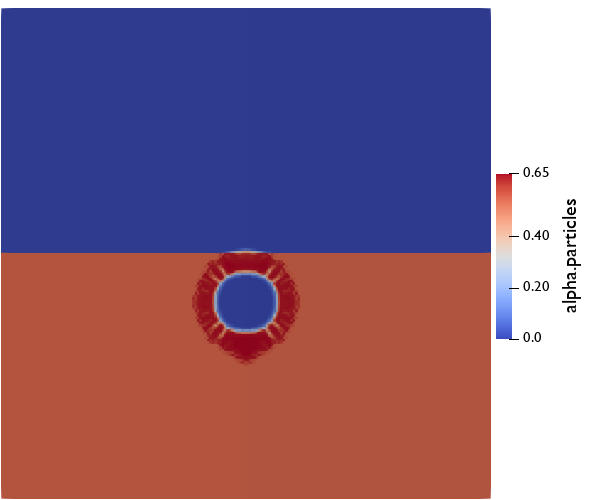

Figure 8: Instantaneous fields at t = 0.0002 s

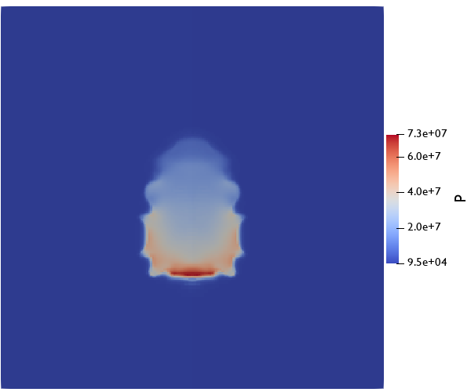

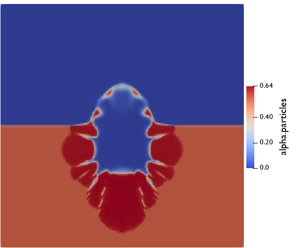

Figure 9: Instantaneous fields at t = 0.002 s

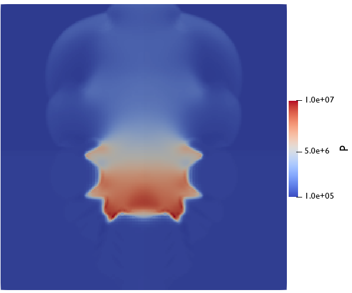

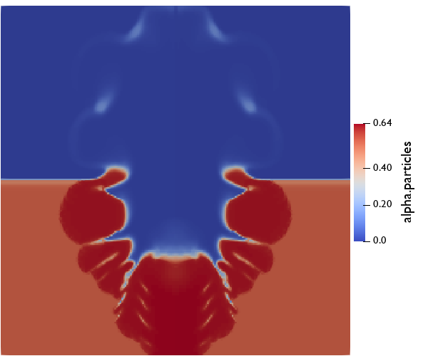

Figure 10: Instantaneous fields at t = 0.005 s

## Bursting windows

This case will demonstrate how to set up a blastFoam case to use burst patches. Only the mesh generation and initial conditions will be described since the other parts of the case setup remain the same.

After constructing the initial mesh using block mesh with bounds (-5, 0, 0) to (10, 10, 10) with a symmetry condition for the x-z plane, snappyHexMesh is used to cut cells from inside the building and refine the faces on the boundary of the "windows" searchableBox. The "geometry" and "castellatedMeshControls" sections are shown below

```cpp
castellatedMesh on;
snap
on;
addLayers
off;
geometry
{
    building
    {
        type triSurfaceMesh;
        file "building.stl";
        scale 0.001;
    }
    windows
    {
        type searchableBox;
        min (1.125 -2.375 -1);
        max (5.875 2.375 3.875);
    }
};
castellatedMeshControls
{
    // Refinement parameters
    // ~~~~~~~~~~~~~~~~~~~~~
    // If local number of cells is >= maxLocalCells on any processor
    // switches from from refinement followed by balancing
    // (current method) to (weighted) balancing before refinement.
    maxLocalCells 10000000;
    // Overall cell limit (approximately). Refinement will stop immediately
    // upon reaching this number so a refinement level might not complete.
    // Note that this is the number of cells before removing the part which
    // is not 'visible' from the keepPoint. The final number of cells might
    // actually be a lot less.
    maxGlobalCells 200000000;
    // The surface refinement loop might spend lots of iterations refining just a
    // few cells. This setting will cause refinement to stop if <= minimumRefine
    // are selected for refinement. Note: it will at least do one iteration
    // (unless the number of cells to refine is 0)
    minRefinementCells 2;
    maxLoadUnBalance 0.1;
    // Number of buffer layers between different levels.
    // 1 means normal 2:1 refinement restriction, larger means slower
    // refinement.
    nCellsBetweenLevels 2;
    resolveFeatureAngle 30;
    allowFreeStandingZoneFaces false;
    features
    (
        {
            file
            "building.extendedFeatureEdgeMesh";
            level 0;
        }
    );
    refinementSurfaces
    {
        building
        {
            level (2 2);
            patchInfo
            {
                type wall;
            }
        }
    }
    refinementRegions
    {
        windows
        {
            mode distance;
            levels ((0.25 2));
        }
    }
    locationInMesh (0 1 1.5);
}
```

Once the mesh has been created with the new building patch, the faces belonging to the widows are selected using topoSet. The topoSetDict is shown below.

```cpp
actions
(
    {
        name
        windows;
        type
        faceZoneSet;
        action
        new;
        source
        searchableSurfaceToFaceZone;
        sourceInfo
        {
            surface searchableBox;
            min (1.125 -2.375 -1);
            max (5.875 2.375 3.875);
        }
    }
);
```

After the necessary faces are selected, the createBaffles utility is used to change the faces to boundary patches named windows_master and windows_slave patches with the burstCyclicAMI patch type. The createBafflesDict can be seen below.

```cpp
// Whether to convert internal faces only
// (so leave boundary faces intact).
// This is only relevant if your face selection type can pick
// up boundary faces.
internalFacesOnly true;
// Baffles to create.
baffles
{
    windows
    {
        //- Use surface to select faces and orientation.
        type
        faceZone;
        zoneName
        windows;
        // Generate patchGroup windows with two patches:
        //
        - windows_master
        //
        - windows_slave
        patchPairs
        {
            type
            burstCyclicAMI;
            partialBurst
            yes;
            pBurst
            5e6;
        }
    }
}
```

The initial conditions for U can be seen below. The same format will be used will all other initial fields.

```cpp
dimensions
[0 0 0 0 0 0 0];
internalField
uniform 0;
boundaryField
{
    //- Set patchGroups for constraint patches
    #include Etc "caseDicts/setConstraintTypes"
    building
    {
        type
        zeroGradient;
    }
    windows_master
    {
        type
        burstCyclicAMI;
        intactPatch
        {
            type
            zeroGradient;
        }
    }
    windows_slave
    {
        type
        burstCyclicAMI;
        intactPatch
        {
            type
            zeroGradient;
        }
    }
    outlet
    {
        type
        zeroGradient;
    }
    ground
    {
        type
        zeroGradient;
    }
    symmetry
    {
        type
        symmetry;
    }
}
```

The following commands were used to run the case in parallel:

```sh
surfaceFeatures
blockMesh
decomposePar -copyZero
mpirun -np 4 snappyHexMesh -overwrite -parallel
mpirun -np 4 topoSet -parallel
mpirun -np 4 createBaffles -overwrite -parallel
mpirun -np 4 setRefinedFields -parallel
mpirun -np 4 blastFoam -parallel
```

Contour plots of the overpressureare on the building shown in Fig. 11 and Fig. 12 at time states of 0.0003 and 0.001 s respectively, and the threshold filter is used to remove burst faces. Note that the results shown here were mirrored during post-processing.

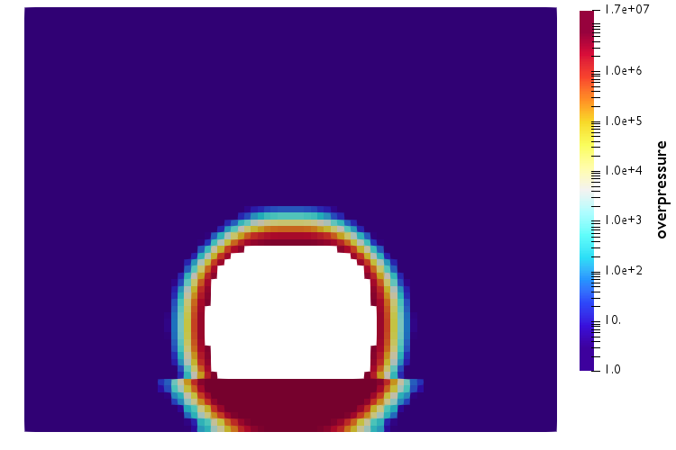

Figure 11: Overpressure field at t = 0.0003 s

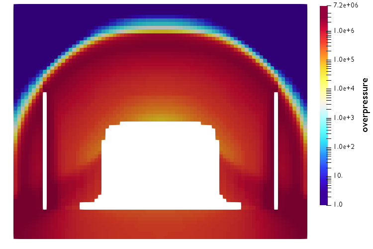

Figure 12: Overpressure field at t = 0.0010 s

# References

Agrawal, K., Loezos, P. N., Syamlal, M., and Sundaresan, S. (2001). The role of meso-scale structures in rapid gas–solid flows. Journal of Fluid Mechanics, 445:151 – 185.

Benedict, M., Webb, G. B., and Rubin, L. C. (1942). An Empirical Equation for Thermodynamic Properties of Light Hydrocarbons and Their Mixtures II. Mixtures of Methane, Ethane, Propane, and n-Butane. The Journal of Chemical Physics, 10(12):747–758. Publisher: American Institute of Physics.

Benyahia, S., Syamlal, M., and O’Brien, T. (2012). Summary of MFIX Equations 2012-1. Technical report.

Broyden, C. G. (1965). A class of methods for solving nonlinear simultaneous equations. Mathematics of Computation, 19(92):577–593.

Cardiff, P. and Demirdzic, I. (2021). Thirty years of the finite volume method for solid mechanics. Archives of Computational Methods in Engineering, 28(5):3721–3780. Publisher: Springer.

Cardiff, P., Karac, A., De Jaeger, P., Jasak, H., Nagy, J., Ivankovic, A., and Tukovic, Z. (2018). An open-source finite volume toolbox for solid mechanics and fluid-solid interaction simulations. arXiv preprint arXiv:1808.10736.

Chao, Z., Wang, Y., Jakobsen, J. P., Fernandino, M., and Jakobsen, H. A. (2011). Derivation and validation of a binary multi-fluid Eulerian model for fluidized beds. Chemical Engineering Science, 66(16):3605–3616.

Chapman, S., Cowling, T. G., and Burnett, D. (1990). The Mathematical Theory of Non-uniform Gases: An Account of the Kinetic Theory of Viscosity, Thermal Conduction and Diffusion in Gases. Cambridge University Press. Google-Books-ID: Cbp5JP2OTrwC.

Dittus, F. W. and Boelter, L. M. K. (1930). Heat transfer in automobile radiators of the tubular type. Number v. 2, no. 13 in University of California publications in engineering. University of California press, Berkeley, Calif.

Doan, L. R. and Nickel, G. H. (1963). A subroutine for the equation of state of air. Technical Report RTD (WLR) TN63-2, Air Force Weapons Labratory.

Enwald, H., Peirano, E., and Almstedt, A.-E. (1996). Eulerian two-phase flow theory applied to fluidization. International Journal of Multiphase Flow, 22:21–66.

Fedors, R. F. and Landel, R. F. (1979). An Empirical method of estimating the void fraction in mixtures of uniform particles of different size. Powder Technology, 23(2):225–231.

Fox, R. O. (2019). A kinetic-based hyperbolic two-fluid model for binary hard-sphere mixtures. Journal of Fluid Mechanics, 877:282–329. Publisher: Cambridge University Press.

Gao, J., Chang, J., Lu, C., and Xu, C. (2008). Experimental and computational studies on flow behavior of gas–solid fluidized bed with disparately sized binary particles. Particuology, 6(2):59–71.

Gelperin, N. I. and Einstein, V. G. (1971). "Heat Transfer in Fluidized Beds. In Fluidization. Academic Press, New York.

Gidaspow, D. (1994). Multiphase Flow and Fluidization: Continuum and Kinetic Theory Descriptions. Elsevier. Google-Books-ID: fHecceQyaYkC.

Giroux, E. D. (1973). HEMP User’s Manual. Lawrence Livermore National Laboratory, University of California. Google-Books-ID: 3XgpHQAA-CAAJ.

Greenshields, C. J., Weller, H. G., Gasparini, L., and Reese, J. M. (2010). Implementation of semi-discrete, non-staggered central schemes in a colocated, polyhedral, finite volume framework, for high-speed viscous flows. International journal for numerical methods in fluids, 63(1):1–21.

Gunn, D. J. (1978). Transfer of heat or mass to particles in fixed and fluidised beds. International Journal of Heat and Mass Transfer, 21:467–476.

Houim, R. W. and Oran, E. S. (2016). A multiphase model for compressible granular–gaseous flows: formulation and initial tests. Journal of Fluid Mechanics, 789:166–220.

Hrenya, C. M. and Sinclair, J. L. (1997). Effects of particle-phase turbulence in gas-solid flows. AIChE Journal, 43(4):853–869. _eprint: https://aiche.onlinelibrary.wiley.com/doi/pdf/10.1002/aic.690430402.

Huilin, L. and Gidaspow, D. (2003). Hydrodynamics of binary fluidization in a riser: CFD simulation using two granular temperatures. Chemical Engineering Science, 58(16):3777–3792.

Johnston, I. A. (2005). The Noble-Abel Equation of State: Thermodynamic Derivations for Ballistics Modeling. Technical Report DSTO-TN-0670, Defense Science and Technology Organisation.

Kochenderfer, M. J. and Wheeler, T. A. (2019). Algorithms for Optimization. MIT Press, Cambridge, MA, USA.

Kurganov, A. and Tadmor, E. (2000). New high-resolution central schemes for nonlinear conservation laws and convection–diffusion equations. Journal of Computational Physics, 160(1):241–282.

Kvaalen, E. (1991). A faster Broyden method. BIT Numerical Mathematics, 31(2):369–372.

Lai, S., Houim, R. W., and Oran, E. S. (2018). Effects of particle size and density on dust dispersion behind a moving shock. Physical Review Fluids, 3(6):064306.

Liou, M.-S. (2006). A sequel to AUSM, Part II: AUSM+-up for all speeds. Journal of Computational Physics, 214(1):137–170.

Lun, C. K. K., Savage, S. B., Jeffrey, D. J., and Chepurniy, N. (1984). Kinetic theories for granular flow: inelastic particles in Couette flow and slightly inelastic particles in a general flowfield. Journal of Fluid Mechanics, 140:223–256.

Luo, H., Baum, J. D., and Löhner, R. (2004). On the computation of multi-material flows using ALE formulation. Journal of Computational Physics, 194(1):304–328.

Lutzky, M. (1964). The flow field behind a spherical detonation in TNT using the landau-stanyukovich equation of state for detonation products. Technical report, NAVAL ORDNANCE LAB WHITE OAK MD.

Löhner, R. (1987). An adaptive finite element scheme for transient problems in CFD. Computer Methods in Applied Mechanics and Engineering, 61(3):323–338.

Mader, C. (1963). Detonation properties of condensed explosives computed using the becker-kistiakowsky-wilson equation of state.

Miller, P. J. (1995). A Reactive Flow Model with Coupled Reaction Kinetics for Detonation and Combustion in Non-Ideal Explosives. MRS Online Proceedings Library Archive, 418.

Needham, C. E. (2018). Blast Waves. Shock Wave and High Pressure Phenomena. Springer International Publishing, Cham.

OpenCFD Ltd. (2018a). OpenFOAM - The Open Source CFD Toolbox - Programer’s Guide. United Kingdom, 2 edition.

OpenCFD Ltd. (2018b). OpenFOAM - The Open Source CFD Toolbox - User’s Guide. United Kingdom, 2 edition.

Rettenmaier, D., Deising, D., Ouedraogo, Y., Gjonaj, E., De Gersem, H., Bothe, D., Tropea, C., and Marschall, H. (2019). Load balanced 2D and 3D adaptive mesh refinement in OpenFOAM. SoftwareX, 10:100317.

Schiller, L. and Naumann, A. (1933). Über die grundlegenden Berechnungen bei der Schwerkraftaufbereitung. Ver. Deut. Ing., 77:318–320.

Shyue, K.-M. (2001). A Fluid-Mixture Type Algorithm for Compressible Multicomponent Flow with Mie–Grüneisen Equation of State. Journal of Computational Physics, 171(2):678–707.

Simo, J. C. and Hughes, T. J. R. (2000). Computational Inelasticity. Springer New York. Google-Books-ID: ftL2AJL8OPYC.

Sinclair, J. L. and Jackson, R. (1989). Gas-particle flow in a vertical pipe with particle-particle interactions. AIChE Journal, 35(9):1473–1486.

Souers, P. C., Anderson, S., Mercer, J., McGuire, E., and Vitello, P. (2000). JWL++: A Simple Reactive Flow Code Package for Detonation. page 5.

Spiteri, R. J. and Ruuth, S. J. (2002). A New Class of Optimal High-Order Strong-Stability-Preserving Time Discretization Methods. SIAM Journal on Numerical Analysis, 40(2):469–491.

Syamlal, M., Rogers, W., and O‘Brien, T. (1993). MFIX documentation theory guide. Technical Report DOE/METC–94/1004, 10145548.

Tillotson, J. H. (1962). Metallic Equations of State For Hypervelocity Impact. General Atomic Report GA-3216. 1962. Technical Report.

Toro, E. F., Spruce, M., and Speares, W. (1994). Restoration of the contact surface in the HLL-Riemann solver. Shock waves, 4(1):25–34.

Wardlaw, A., Mckeown, R., and Luton, A. (1998). Coupled hydrocode prediction of underwater explosion damage. Technical report, NAVAL SURFACE WARFARE CENTER INDIAN HEAD DIV MD.

Williams, M. L., Landel, R. F., and Ferry, J. D. (1955). The Temperature Dependence of Relaxation Mechanisms in Amorphous Polymers and Other Glass-forming Liquids. Journal of the American Chemical Society, 77(14):3701–3707. Publisher: American Chemical Society.

Woodward, P. and Colella, P. (1984). The numerical simulation of two-dimensional fluid flow with strong shocks. Journal of Computational Physics, 54(1):115–173.

Xie, W., Zhang, R., Lai, J., and Li, H. (2019). An accurate and robust HLLC-type Riemann solver for the compressible Euler system at various Mach numbers. International Journal for Numerical Methods in Fluids, 89(10):430–463.

Xue, Q., Heindel, T. J., and Fox, R. O. (2011). A CFD model for biomass fast pyrolysis in fluidized-bed reactors. Chemical Engineering Science, 66(11):2440–2452.

Yu, A. B. and Standish, N. (1987). Porosity calculations of multi-component mixtures of spherical particles. Powder Technology, 52(3):233–241.

Zheng, H., Shu, C., and Chew, Y. (2008). An object-oriented and quadrilateral-mesh based solution adaptive algorithm for compressible multi-fluid flows. Journal of Computational Physics, 227(14):6895–6921.

Zheng, H. W., Shu, C., Chew, Y. T., and Qin, N. (2011). A solution adaptive simulation of compressible multi-fluid flows with general equation of state. International Journal for Numerical Methods in Fluids, 67(5):616–637.

Zheng, Z. and Zhao, J. (2016). Unreacted equation of states of typical energetic materials under static compression: A review. Chinese Physics B, 25(7):076202.
