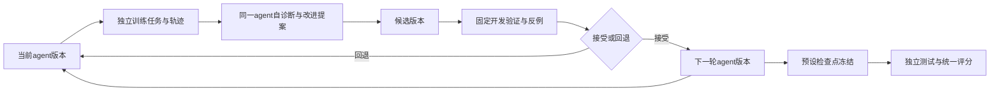

# 基于DSH的单智能体RSI实验设计

2026-10-04。状态：设计草案，尚未实现DSH自进化控制器，也没有DSH自进化收益数据。维护源码统一放本DSH项目，实验进入外部`chapter4_self_evolution/`归档，论文仅在`graduation-thesis-materials/graduation-manuscript/`编写。

## 🧭 研究对象与现有基础

第4章独立研究递归自改进（RSI）：默认一个agent，使用DSH作为运行框架，自主分析自身任务轨迹、提出自身改进、验证候选版本，并由接受后的新版本继续参与下一轮改进。第4章不继承第3章的协调者、专家角色、阶段编排、七项产物契约或多智能体bundle，也不以第3章完成或轨迹产出为前置条件。

本轮研究系统层的递归自改进，底层模型权重保持固定。可演化对象为单agent的策略提示、经验技能、受约束插件配置，以及后续单独消融的自改进策略。只做一次技能抽取与注入属于非递归对照，不能直接当作RSI证据。

实现应建立独立的单agent profile、配置入口、技能目录与运行清单，不加载第3章的多角色bundle或spawn角色工具；单agent工具白名单还应排除通用spawn/subagent入口，防止运行时隐式新增agent。可以复用通用DSH版本管理和经过明确验证的基础领域工具，但这种代码复用不构成章节研究依赖。当前仓库中的多智能体适配器不能直接当作RSI运行器。

DSH在本实验中的候选优势是：技能内容、策略配置和确定性检查可以分别版本化，通过独立profile/patch装载，回退无需改宿主代码。它也引入生成代码审核、服务生命周期与配置合成成本；是否值得采用，由对照实验决定。

## 🔬 研究问题与可检验假设

| 问题 | 候选假设 | 对应比较与否证条件 |
| --- | --- | --- |
| H1：递归自改进是否有效 | 多轮接受后的agent版本在独立测试任务上优于冻结初始版本 | R对B；报告累计改进成本与逐轮轨迹，未改善则不支持 |
| H2：递归反馈是否优于一次性经验注入 | 同等累计改进预算下，递归版本优于一次性改进版本 | R对S；不能用R额外的模型调用冒充递归机制收益 |
| H3：验证与回退能否控制退化 | 开发环境验证与版本回退减少退化和不适用操作 | 在开发与反例环境消融，外部最终评分器始终固定 |

插件是可选的改进载体，底层模型权重与单agent数量固定。第一阶段不让模型修改任意宿主、评分器或工具实现。

## 🧩 经验资产与演化闭环

每轮记录当前版本E_t、该版本的任务轨迹、自诊断、改进提案、候选版本、开发验证、接受或回退决策。接受后的E_(t+1)承担下一轮任务与自改进；离线统计脚本和确定性验证器不是额外agent。不额外设置反思agent、评审agent或协调agent。正式测试只评估预先冻结的检查点，不参与同轮版本选择。

每个资产保留：来源运行与哈希、失败/成功证据、适用范围、触发条件、禁止条件、操作建议、独立验证方法、版本及父版本。教程名称可用于训练来源追溯，不能把测试专用答案、文件修改结果或命令配方藏入通用技能。

文本技能使用独立实验项目的`.dsh/skills/<name>/SKILL.md`入口，不自动继承第3章七项工作阶段技能。活动按版本快照装载，避免共享目录污染。可执行插件先采用人工审核过的固定模板，只允许模型提出适用条件与检查配置。若需要新代码，在隔离候选包中实现并通过验收，不直接加载模型输出。



每个实验臂只有一个agent，执行与自改进是同一agent在不同会话阶段承担的任务。插件可提供局部预检、适用性记录或诊断，不修改公共评分器、不伪造产物、不扩大权限。插件有无另作载体消融，不预设是RSI核心机制。

## ⚖️ 主比较与消融

| 实验臂 | 运行资产 | 固定条件 |
| --- | --- | --- |
| B：冻结初始agent | 单agent基础提示与必要领域工具，版本不更新 | DSH、底层模型、工具权限、任务执行预算及评分固定 |
| S：一次性自改进 | 同一agent使用训练证据一次性形成改进版本，随后冻结 | 与R匹配累计改进预算，独立报告实际消耗 |
| R：递归自改进 | 同一agent多轮提出、验证并接受自身版本更新 | 同一开发任务池与累计改进预算，终止规则预先声明 |
| D：开发消融 | 固定起始版本生成候选、去掉局部插件、去掉接受门禁等 | 仅在开发环境诊断，不改变最终公共评分 |

各臂共享单agent必要的基础能力，不导入第3章的工作阶段规程。记录任务执行成本与自改进成本，分别报告等任务执行预算与等累计改进预算下的比较。多轮反馈、候选生成与验证均计入RSI成本。

预先固定每轮开发验证、最多轮数、候选数、接受条件和退化回退规则。主实验先固定改进策略以识别递归反馈的作用；若研究agent改进自身的改进策略，另设明确消融，不能悄悄扩大主实验演化范围。

## 🗂️ 题集与泄漏控制

现有最新`chapter4_self_evolution_eval_benchmark.json`实际有11项：2训练种子、8留出、1负对照。旧12-case题集是历史场景池，不再默认作为三组正式主比较。历史2/8/1题集已经被旧实现使用，迁移到DSH时可以作为工程试点，不能宣称首次未见泛化；历史Deep Agents分数不能与新DSH分数混合配对。

试点全部臂使用独立DSH单agent运行器，验证多轮版本更新、接受/回退与共同评分链路。正式研究另行冻结按场景族隔离的训练、开发、测试与多个负对照；先按预期最小效应和成本进行样本量设计，再确定规模，不用8任务显著性作为普遍收益保证。

第4章独立生成单agent训练轨迹与开发反馈，不使用第3章失败轨迹作为预设学习来源。训练、开发、测试按任务族及共享配方隔离。测试集不锁定，但查看或使用过的结果须披露暴露；正式测试不用于同轮版本选择。

## 📏 独立评分与统计

成功由第4章独立冻结的任务契约与共同评分器确定，不继承第3章七项报告要求。若具体任务要求仿真，可检查配置、求解健康、必要输出与有限数值；这些是任务验证项，不强制拆成专家阶段。非执行任务与要求求解任务分别统计，不把缺少求解的任务算作全流程成功。

主指标是最终冻结版本的任务族级配对成功率差；补充逐轮能力曲线、接受/回退率、退化率和单位累计改进成本收益；同时报告部分完成、求解成功而后处理失败、假成功率、拒绝/误阻断率、技能触发与真实使用、token、API调用、CPU/求解时间和总wall time。多次运行先在任务族内聚合，再做配对bootstrap；小样本试点报告逐任务结果和区间，不靠重复运行扩大独立样本数。

H1和H2为预先声明的两个主要比较；正式协议确定多重比较处理、置信区间、重试与缺失规则。技能文本提及率不等于有效使用，必须由工具调用、修改差异和验证证据支撑。

## 🧪 实施顺序与准入

1. 固定DSH宿主、独立单agent profile、初始agent版本、底层模型、工具与第4章评分器；先实现并验证独立RSI运行器的dry-run与一次完整版本更新/回退。
2. 定义训练轨迹、技能卡、候选检查与冻结清单契约；接入现有领域工具，不修改上游DSH。
3. 在训练轨迹抽取候选，再在开发/反例环境检查作用域、误阻断、缺少日志、字段不全和求解失败处理。基础校验不得关闭。
4. 用独立单agent profile运行B/S/R试点。记录每轮当前/候选版本、反馈、接受决策、配置、工具、经验资产与本章任务契约证据。
5. 完成开发准入后冻结正式协议与新任务划分，执行配对正式比较；形成质量、成本、失败边界及负对照报告。

插件生命周期验收必须覆盖加载、处置、重复装载及回退；注册方式按兼容版本的官方机制实现，不能把当前提示注册插件假定成已有拦截器。递归轮次顺序推进；不同实验臂可在独立profile与输出目录中运行，每个臂仍仅有一个agent。

## 📦 源码与归档布局

维护中的自进化适配器、资产契约与导出工具放本目录；可安装插件放`packages/`对应候选包，不把业务逻辑写入上游宿主。正式输出建议为：

```text
chapter4_self_evolution/dsh/<campaign>/
  protocol.json
  manifests/
  assets/<version>/
  candidates/
  runs/{baseline,one_shot,rsi}/
  generations/<round>/
  verifier/
  comparisons/
```

运行清单绑定宿主commit、应用commit及未提交源码快照哈希、精确模型、bundle/profile合成配置、技能/插件/语料/题集/评分器哈希。不能只记录Git HEAD而遗漏当前未提交实现。凭据不进入归档。论文正式图件最终写入稿件`assets/chapter4/`。

本设计无需立即调用模型或运行求解器。下一项实现任务是独立单agent配置、递归版本契约与RSI运行器；正式实验尚未开始。
